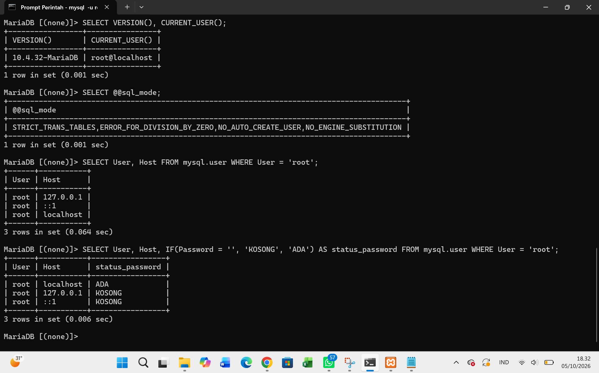
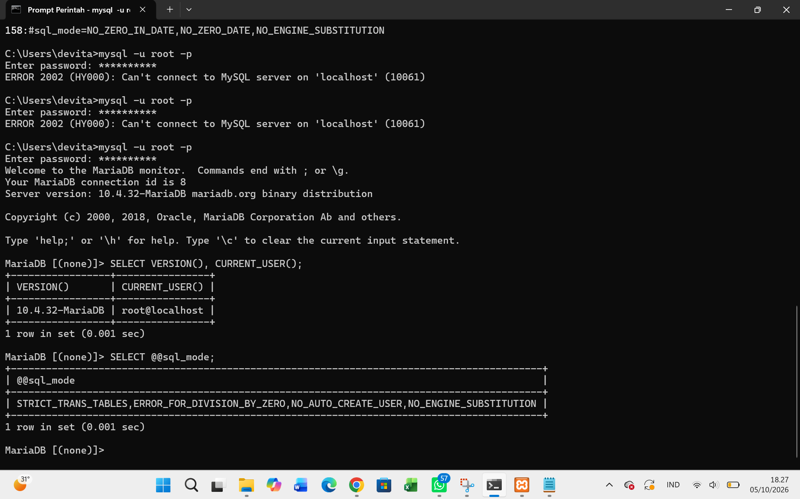
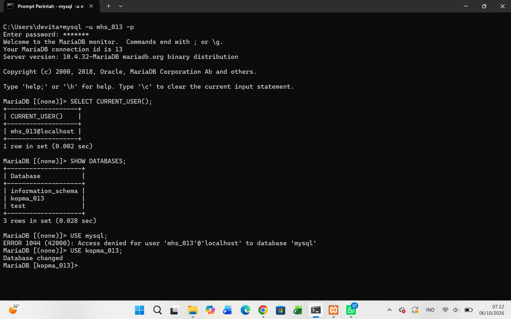
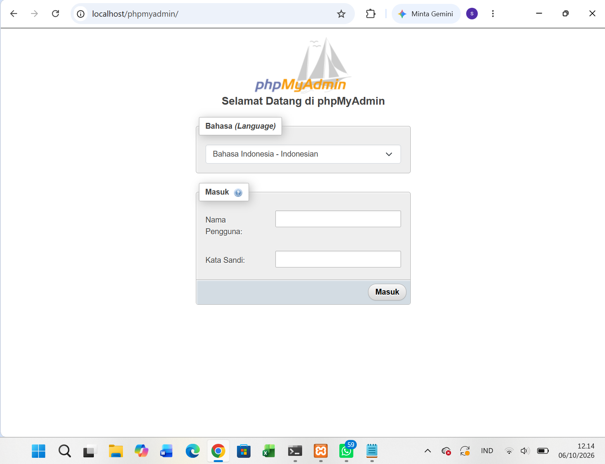
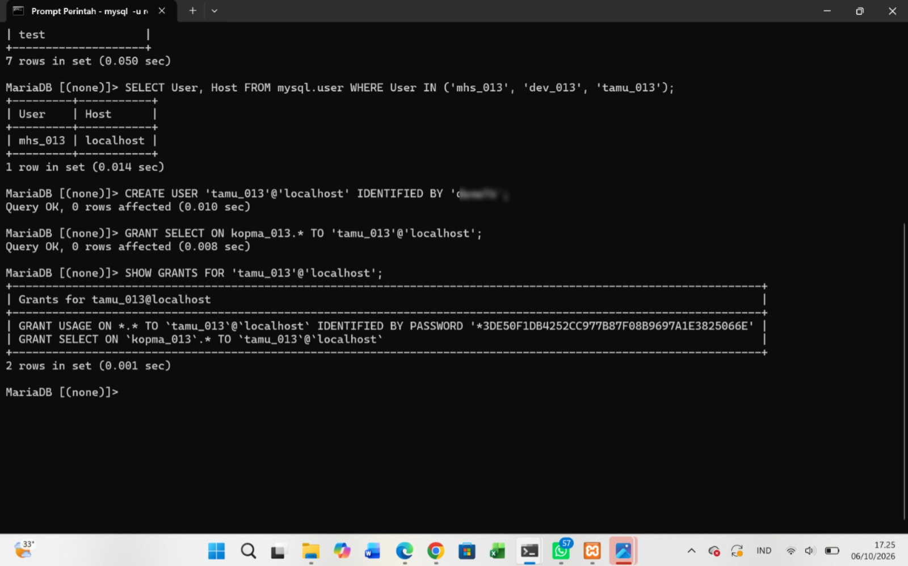
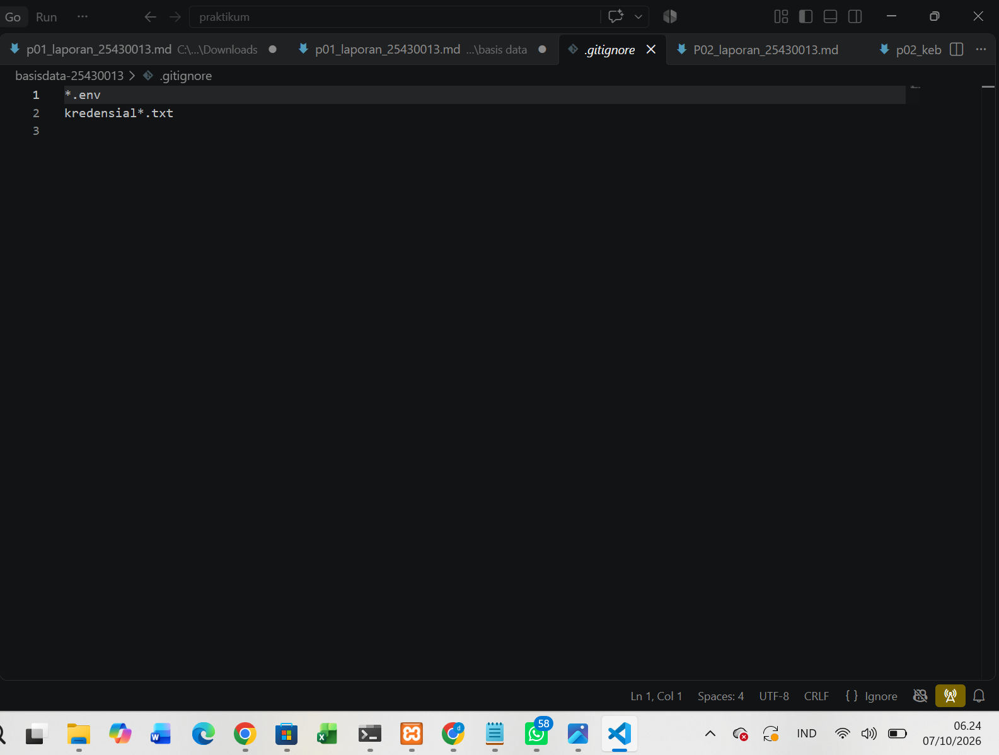
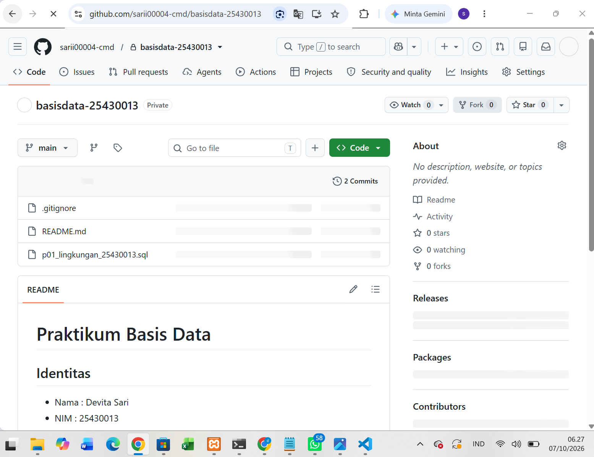

Laporan Praktikum Basis Data - Pertemuan 1

Nama: Devita Sari
NIM: 25430013
Kelas: A
Tanggal: 01 oktober 2026

1. Tujuan Praktikum

Setelah menyelesaikan praktikum ini, saya dapat memahami cara menjalankan MariaDB melalui XAMPP, melakukan koneksi ke server melalui Command Prompt, mengenal akun dan hak akses pada MariaDB, membuat basis data, serta menggunakan Git dan GitHub untuk mencatat dan menyimpan pekerjaan praktikum.

2. Ringkasan Dasar Teori

Menurut pemahaman saya, MariaDB menggunakan pola klien-server. Klien seperti Command Prompt dan phpMyAdmin digunakan untuk mengirim perintah kepada server MariaDB, sedangkan MariaDB menjalankan dan mengelola database. Pada praktikum ini server menggunakan port 3306.
MariaDB memiliki hubungan yang sangat dekat dengan MySQL karena MariaDB dikembangkan dari MySQL dan menggunakan banyak konsep serta sintaks SQL yang sama. Namun, dokumentasi yang digunakan tetap perlu disesuaikan dengan database server yang sedang digunakan.
Saya juga memahami bahwa akun MariaDB ditentukan berdasarkan pasangan pengguna@host, sehingga root@localhost dan root@127.0.0.1 dapat menjadi akun yang berbeda. Dalam pemberian hak akses digunakan prinsip least privilege, yaitu akun hanya diberikan hak yang diperlukan untuk pekerjaannya.
Selain itu, Git digunakan untuk mencatat perubahan pekerjaan melalui commit, sedangkan GitHub digunakan untuk menyimpan repositori secara daring sehingga proses pengerjaan dapat dilacak.

3. Hasil Langkah Percobaan

D.1 Menjalankan Layanan MariaDB
MariaDB dijalankan melalui XAMPP Control Panel. Setelah tombol Start pada bagian MySQL dijalankan, server berhasil aktif dan menggunakan port 3306.
Pada proses pengerjaan, server MariaDB juga sempat mengalami kendala sehingga perlu dijalankan kembali melalui mysqld.exe --console. Setelah server berhasil berjalan, koneksi ke MariaDB dapat dilakukan melalui Command Prompt.
Bukti:
[-2.png>)]

D.2 Masuk Melalui Klien Baris Perintah
Saya berhasil masuk ke MariaDB melalui Command Prompt menggunakan akun root. Beberapa pemeriksaan yang dilakukan adalah:
SELECT VERSION(), CURRENT_USER();
Hasil menunjukkan bahwa server yang digunakan adalah MariaDB 10.4.32.
Saya juga menjalankan:
SHOW DATABASES;

Basis data yang terlihat antara lain:
information_schema
kopma_013
mysql
performance_schema
perpus_013
phpmyadmin
test
Kemudian dilakukan pemeriksaan mode SQL:
SELECT @@sql_mode;
Mode SQL kemudian digunakan dengan pengaturan strict yang mencakup STRICT_TRANS_TABLES.
Bukti:
[]

D.3 Mengamankan Akun Root
Akun root diamankan menggunakan password. Setelah pengamanan dilakukan, login kembali ke MariaDB dilakukan menggunakan:
mysql -u root -p
Pada proses ini saya juga memahami bahwa penggunaan -p membuat MariaDB meminta password ketika melakukan login.
Bukti:
[]
Catatan: Password asli jangan ditulis di laporan atau file GitHub.

D.4 Membuat Basis Data dan Akun Kerja
Basis data proyek yang digunakan kemudian dibuat dengan nama:
perpus_013
Basis data menggunakan utf8mb4 dan utf8mb4_unicode_ci.
Saya juga menggunakan akun kerja:
mhs_013
Akun tersebut digunakan untuk melakukan pekerjaan database tanpa selalu menggunakan akun root.
Pada tahap ini saya memahami bahwa pemberian hak akses pada akun dilakukan berdasarkan kebutuhan dan database yang dikerjakan.
Bukti:
[]

D.5 Menggunakan phpMyAdmin
phpMyAdmin digunakan sebagai alternatif antarmuka untuk berinteraksi dengan MariaDB. Pengaturan autentikasi diarahkan ke mode cookie, sehingga pengguna harus memasukkan akun dan password ketika login.
Bukti:
[]

D.6 Menyiapkan Repositori Git
Pekerjaan praktikum disimpan dalam folder:
D:\DATA\perpus_013
File yang telah digunakan dalam repositori antara lain:
.gitignore
README.md
p01_lingkungan_013.sql
Repositori kemudian diinisialisasi dan dilakukan commit. Salah satu commit yang telah dibuat adalah:
Modul 1: persiapan lingkungan database
Repositori juga telah terhubung dengan GitHub dan dilakukan push.
Bukti:
[https://github.com/]

4. Jawaban Titik Analisis

Titik Analisis 1
Label pada XAMPP bertuliskan MySQL, tetapi server yang digunakan sebenarnya adalah MariaDB. Konsekuensinya, ketika mencari solusi masalah di internet, saya harus memperhatikan versi dan jenis database yang digunakan. Dokumentasi MySQL masih relevan untuk konsep dan sintaks yang sama, tetapi untuk fitur, konfigurasi, atau pesan error yang spesifik saya perlu merujuk pada dokumentasi MariaDB.

Titik Analisis 2
Ketika root sudah diberi password, login menggunakan:
mysql -u root
tidak mengirimkan password kepada server. Oleh karena itu, login dapat ditolak dengan ERROR 1045 Access denied. Berbeda dengan:
mysql -u root -p
yang meminta password kepada pengguna.

Titik Analisis 3
information_schema tetap dapat terlihat karena merupakan basis data sistem yang menyediakan informasi mengenai objek database yang dapat diketahui oleh pengguna. Sementara itu, mysql berisi tabel sistem yang aksesnya lebih terbatas.
ERROR 1044 berkaitan dengan akses pengguna terhadap database, sedangkan ERROR 1045 berkaitan dengan kegagalan autentikasi atau kredensial saat login.

Titik Analisis 4
Mode cookie lebih aman dibandingkan mode config karena password tidak disimpan langsung di dalam file konfigurasi untuk login otomatis. Pengguna harus memasukkan kredensial ketika melakukan login ke phpMyAdmin.

5. Hasil Latihan dan Modifikasi

E.1 Membuat Akun Tamu
Latihan E.1 meminta pembuatan akun tamu_013 yang hanya mempunyai hak SELECT pada database latihan.
Pada proses pengerjaan, akun tamu_013 telah dibuat.
Hasil pengujian:
[]
Jika akun hanya mempunyai hak SELECT, maka akun tersebut seharusnya tidak dapat membuat tabel karena CREATE bukan bagian dari hak akses yang diberikan.
Bukti:
[]

E.2 Membuat Skrip Dapat Dijalankan Ulang
Latihan E.2 meminta skrip SQL dimodifikasi agar dapat dijalankan kembali tanpa menimbulkan error karena objek sudah ada.
Perintah yang digunakan perlu menggunakan bentuk seperti:
CREATE DATABASE IF NOT EXISTS ...
dan:
REATE USER IF NOT EXISTS ...
Status: [BELUM DIKONFIRMASI / ISI SETELAH SUDAH DIUJI 2 KALI]

6. Tugas Mandiri: Milestone Proyek 1

Tema proyek yang digunakan adalah perpustakaan dengan nama database:
perpus_013
Database dibuat menggunakan karakter set:
utf8mb4
dan collation:
utf8mb4_unicode_ci
Proyek ini digunakan sebagai dasar untuk pengembangan database perpustakaan pada pertemuan berikutnya.
Akun kerja yang digunakan adalah:
mhs_013
Repositori proyek juga telah disiapkan menggunakan Git. File awal yang digunakan adalah:
.gitignore
README.md
p01_lingkungan_013.sql
Status Milestone: Sebagian pekerjaan telah dilakukan, tetapi checklist milestone perlu dicocokkan kembali dengan bukti terakhir sebelum dinyatakan 100% selesai.
Bukti:
[]
[]
[]

7. Pembahasan dan Kendala

Selama praktikum terdapat beberapa kendala dalam menjalankan MariaDB. Pada awal pengerjaan, layanan MariaDB sempat mengalami masalah sehingga server tidak dapat berjalan secara normal melalui XAMPP. Untuk mengatasinya, server dijalankan melalui mysqld.exe --console sampai dapat menerima koneksi kembali.
Selain itu, terdapat kendala saat melakukan koneksi ulang ke MariaDB yang sempat menghasilkan ERROR 1045 Access denied. Setelah melakukan login menggunakan metode yang benar, koneksi berhasil dilakukan.
Pada proses pengerjaan database proyek juga pernah terjadi ERROR 2006 MySQL server has gone away ketika melakukan operasi pada database. Setelah server dijalankan kembali, koneksi dapat digunakan kembali.
Dari kendala tersebut saya belajar bahwa pesan error perlu dibaca terlebih dahulu sebelum menentukan tindakan perbaikan. Saya juga menjadi lebih memahami hubungan antara XAMPP, server MariaDB, akun pengguna, dan klien yang digunakan untuk mengakses database.

8. Kesimpulan

Setelah melakukan praktikum, saya lebih memahami cara menjalankan MariaDB melalui XAMPP dan melakukan koneksi melalui Command Prompt maupun phpMyAdmin. Saya juga memahami bahwa akun MariaDB memiliki identitas berdasarkan pengguna@host dan hak akses harus diberikan sesuai kebutuhan. Selain itu, saya mulai memahami penggunaan Git dan GitHub untuk mencatat serta menyimpan proses pengerjaan database secara bertahap.

9. Pernyataan Penggunaan AI

Dalam pengerjaan praktikum ini saya menggunakan ChatGPT sebagai asisten untuk membantu memahami konsep, membaca dan menjelaskan pesan error.
Saya tetap melakukan praktik, menjalankan perintah, memeriksa hasil, dan menentukan hasil akhir berdasarkan lingkungan MariaDB, XAMPP, dan Git yang saya gunakan.

10. Bukti Git

Repository: [MASUKKAN LINK REPOSITORY GITHUB]

Commit: 52fc056

Pesan commit:
Modul 1: persiapan lingkungan database

Branch: main

Checklist
 [] D.1–D.6 selesai
 [] Titik Analisis 1–4 dijawab
 [] E.1–E.2 selesai
 [] Milestone Proyek 1 selesai
 [] Bukti screenshot lengkap
 [] Git commit dan push