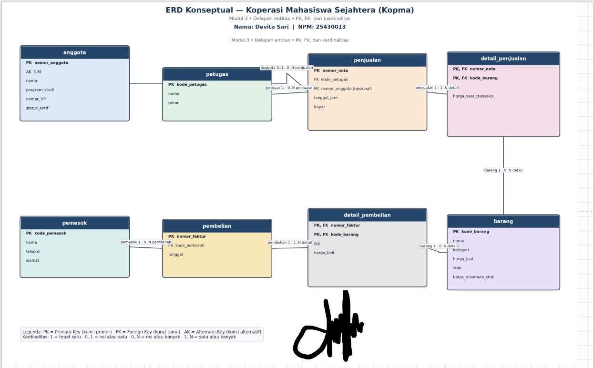
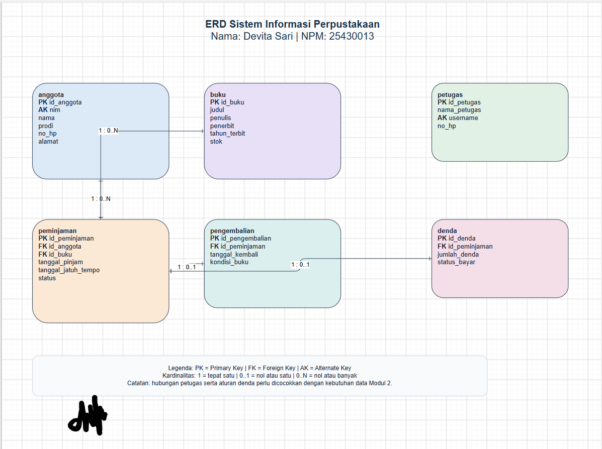

# Laporan Praktikum Basis Data - Pertemuan 03

Nama: Devita Sari  
NIM: 25430013  
Kelas: A 
Tanggal:11 oktober 2026

### 1. Tujuan Praktikum

Tujuan praktikum Modul 3 adalah memahami pemodelan data menggunakan Entity-Relationship Diagram (ERD), mengidentifikasi entitas dan atribut, menentukan hubungan serta kardinalitas ant entitas, dan menyusun ERD proyek perpustakaan berdasarkan kebutuhan data yang telah dianalisis pada Pertemuan 2.

### 2. Ringkasan Dasar Teori

Entity-Relationship Diagram (ERD) merupakan diagram yang digunakan untuk menggambarkan entitas, atribut, dan hubungan ant entitas dalam suatu sistem basis data. Entitas mewakili objek yang datanya dikelola, sedangkan atribut menjelaskan karakteristik entitas tersebut.

Relasi menunjukkan hubungan antar entitas, sementara kardinalitas menjelaskan jumlah keterhubungan ant entitas, seperti satu-ke-satu, satu-ke-banyak, atau banyak-ke-banyak. ERD membantu memastikan kebutuhan informasi dapat dipenuhi melalui struktur data yang dirancang sebelum masuk ke tahap normalisasi dan pembuatan tabel.

### 3. Hasil Langkah Percobaan

## 3.1 Identifikasi Entitas dan Atribut
# Tabel Entitas Kandidat
| Entitas Kandidat	| Elemen Data Utama	| Sumber |
| Anggota	| nomor anggota, NIM, nama, program studi, nomor HP, status aktif	| Formulir pendaftaran |
| Barang | kode, nama, kategori, harga jual, stok, batas minimum stok	| Daftar barang |
| Penjualan	| nomor nota, tanggal-jam, kasir, anggota (opsional), bayar	| Nota penjualan |
| Detail Penjualan	| nomor nota, barang, qty, harga saat transaksi	| Nota penjualan |
| Petugas	| kode petugas, nama, peran (kasir/gudang/ketua)	| Wawancara |
| Pemasok	| kode, nama, telepon, alamat	| Faktur pemasok |
| Pembelian	| nomor faktur, tanggal, pemasok	| Faktur pemasok |
| Detail Pembelian	nomor faktur, barang, qty, harga beli | Faktur pemasok |
penjelasan: 
1. Anggota: Entitas yang menyimpan identitas mahasiswa yang terdaftar sebagai anggota Kopma, seperti nomor anggota, NIM, nama, program studi, nomor HP, dan status aktif.
2. Barang: Entitas yang menyimpan informasi barang yang dijual Kopma, termasuk kode barang, nama, kategori, harga jual, jumlah stok, dan batas minimum stok.
3. Penjualan: Entitas yang mencatat transaksi penjualan, meliputi nomor nota, tanggal dan waktu transaksi, petugas kasir, anggota jika ada, serta informasi pembayaran.
4. Detail Penjualan: Entitas yang mencatat rincian barang dalam setiap transaksi penjualan, seperti barang yang dibeli, jumlah barang, dan harga pada saat transaksi. Entitas ini memisahkan rincian barang dari informasi utama penjualan.
5. Petugas: Entitas yang menyimpan informasi petugas Kopma, termasuk kode petugas, nama, dan peran sebagai kasir, petugas gudang, atau ketua.
6. Pemasok: Entitas yang menyimpan identitas pihak yang memasok barang ke Kopma, meliputi kode pemasok, nama, nomor telepon, dan alamat.
7. Pembelian: Entitas yang mencatat transaksi pembelian barang dari pemasok, berdasarkan nomor faktur, tanggal pembelian, dan pemasok yang terlibat.
8. Detail Pembelian: Entitas yang menyimpan rincian barang dalam setiap transaksi pembelian, meliputi barang yang dibeli, jumlah, dan harga beli.

# Tabel Entitas Setelah Identifikasi Kunci
| Entitas	| Kunci Utama (PK)	| Kunci Alternatif (AK)	| Atribut Lain |
| anggota	| nomor_anggota	| nim |  nama, program_studi, nomor_hp, status_aktif |
| barang	| kode_barang	| —	| nama, kategori, harga_jual, stok, batas_minimum_stok |
| penjualan	| nomor_nota	| —	| tanggal_jam, kasir, anggota (opsional), bayar |
| detail_penjualan	| nomor_nota + kode_barang*	| —	 | qty, harga_saat_transaksi |
| petugas	| kode_petugas	| —	| nama, peran |
| pemasok	| kode_pemasok	| —	| nama, telepon, alamat |
| pembelian	| nomor_faktur	| —	| tanggal, pemasok |
| detail_pembelian	| nomor_faktur + kode_barang*	| —	| qty, harga_beli |
penjelasan:
1. anggota : nomor_anggota menjadi PK untuk membedakan setiap anggota. nim dapat menjadi AK apabila setiap 
anggota memiliki NIM yang unik.
2. barang	: kode_barang menjadi PK agar setiap barang dapat diidentifikasi secara unik.
3. penjualan	: nomor_nota menjadi PK untuk membedakan setiap transaksi penjualan.
4. detail_penjualan	: Menggunakan gabungan nomor_nota dan kode_barang sebagai usulan PK untuk mengidentifikasi rincian barang pada nota.
5. petugas	: kode_petugas menjadi PK untuk membedakan setiap petugas Kopma.
pemasok	kode_pemasok menjadi PK untuk membedakan setiap pemasok.
6. pembelian	: nomor_faktur menjadi PK untuk mengidentifikasi transaksi pembelian.
7. detail_pembelian	: Menggunakan gabungan nomor_faktur dan kode_barang sebagai usulan PK untuk mengidentifikasi rincian barang pada faktur.

# tabel Atribut Turunan
| Entitas	| Atribut Turunan	| Dasar Perhitungan | Penjelasan |
| detail_penjualan	|subtotal	| qty × harga_saat_transaksi | Nilai hasil perkalian jumlah barang dengan harga jual per unit saat transaksi.|
| penjualan	| jumlah	| Jumlah seluruh subtotal detail penjualan | Total nilai seluruh subtotal barang sebelum diskon.|
| penjualan	| total	| Jumlah penjualan dikurangi diskon, jika ada | Nilai pembayaran setelah jumlah penjualan dikurangi diskon yang berlaku |
| detail_pembelian	| subtotal_beli	| qty × harga_beli | Nilai hasil perkalian jumlah barang yang dibeli dengan harga beli per unit.|
| pembelian	| total_pembelian	| Jumlah seluruh subtotal pembelian | Total nilai seluruh rincian barang dalam satu transaksi pembelian.|

## 3.2 Perancangan Relasi dan Kardinalitas
# Tabel 3.2 Relasi dan Kardinalitas Kopma
| Relasi	| Sisi kiri	| Sisi kanan	| Dasar |
| Petugas melayani penjualan	| Tepat satu petugas	| Nol atau banyak penjualan	| Wawancara kasir |
| Anggota melakukan penjualan	| Nol atau satu anggota	| Nol atau banyak penjualan	| AB-02 |
| Penjualan berisi detail_penjualan	| Tepat satu penjualan	| Satu atau banyak detail	| AB-01 |
| Barang tercantum di detail_penjualan	| Tepat satu barang	| Nol atau banyak detail	| AB-04 |
| Pemasok menerima pembelian	| Tepat satu pemasok	| Nol atau banyak pembelian	| AB-06 |
| Pembelian berisi detail_pembelian	| Tepat satu pembelian	| Satu atau banyak detail	| Faktur pemasok |
penjelasan: 
1. Petugas melayani penjualan
Setiap transaksi penjualan dilayani oleh tepat satu petugas. Seorang petugas dapat melayani nol atau banyak transaksi penjualan, karena petugas baru mungkin belum pernah melayani transaksi.
2. Anggota melakukan penjualan
Satu transaksi penjualan dapat melibatkan nol atau satu anggota. Nol berarti transaksi dilakukan oleh pembeli umum yang bukan anggota. Seorang anggota dapat melakukan nol atau banyak transaksi penjualan.
3. Penjualan berisi detail_penjualan
Setiap detail penjualan harus terkait dengan tepat satu transaksi penjualan. Satu transaksi penjualan harus memiliki minimal satu detail dan dapat memiliki banyak detail jika pembeli membeli beberapa jenis barang.
4. Barang tercantum di detail_penjualan
Setiap detail penjualan mengacu pada tepat satu barang. Satu barang dapat belum pernah terjual atau muncul dalam banyak detail penjualan.
5. Pemasok menerima pembelian
Setiap transaksi pembelian dilakukan kepada tepat satu pemasok. Satu pemasok dapat belum memiliki transaksi pembelian atau dapat memiliki banyak transaksi pembelian.
6. Pembelian berisi detail_pembelian
Setiap detail pembelian harus terkait dengan tepat satu transaksi pembelian. Satu transaksi pembelian memiliki minimal satu detail barang dan dapat memiliki banyak detail.
7. Barang tercantum di detail_pembelian
Setiap detail pembelian mengacu pada tepat satu barang. Satu barang dapat belum pernah dibeli atau dapat muncul dalam banyak detail pembelian.

### 3.3 Menggambar ERD
# link drawio: [text](../../p03_erd_kopma__25430013_.drawio)
# hasil tangkap layar : 

## 3.4 Memvalidasi ERD terhadap kebutuhan informasi
# Hasil validasi ERD terhadap kebutuhan informasi
| Kode	| Kebutuhan Informasi | Jalur pada ERD | Hasil Validasi | 
| KI-01	| Omzet dan jumlah nota per hari dan per bulan penjualan → detail_penjualan	| Perlu dilengkapi |
| KI-02	| Lima barang terlaris per bulan berdasarkan kuantitas barang → detail_penjualan → penjualan | Perlu dilengkapi |
| KI-03	| Barang dengan stok di bawah batas minimum	barang	| Terpenuhi |
| KI-04	| Sepuluh anggota dengan belanja terbesar per bulan	anggota → penjualan → detail_penjualan	| Perlu dilengkapi |
yang perlu diperbaiki
1. KI-01: tabel penjualan sudah memiliki tanggal_jam dan bayar, tetapi perlu dipastikan apakah bayar menyimpan total nilai transaksi atau jumlah uang yang dibayarkan pelanggan. Omzet sebaiknya dihitung dari nilai penjualan sebenarnya.
2. KI-02: tabel detail_penjualan perlu memiliki atribut qty atau kuantitas barang terjual. Pada gambar, atribut ini belum terlihat.
3. KI-03: tabel barang sudah memiliki stok dan batas_minimum_stok, sehingga kebutuhan ini dapat dipenuhi.
4. KI-04: jalur relasinya sudah tersedia melalui anggota, penjualan, dan detail_penjualan. Namun, perhitungan belanja terbesar memerlukan kuantitas dan harga jual setiap barang.

# perbaikan yag dilakukan oler ERD
1. — Entitas detail_penjualan
Tambahkan atribut: qty — jumlah barang yang terjual.
Struktur akhirnya menjadi:
- nomor_nota — PK, FK
- kode_barang — PK, FK
- qty
- harga_saat_transaksi
2.  — Perhitungan omzet
Gunakan qty × harga_saat_transaksi untuk menghitung nilai penjualan tiap barang. Jumlahkan nilai tersebut berdasarkan tanggal transaksi di tabel penjualan.
Jumlah nota dihitung dari jumlah transaksi pada tabel penjualan.
3.  — Total belanja anggota
Pastikan penjualan.nomor_anggota terhubung dengan anggota.nomor_anggota. Total belanja dihitung dari kuantitas dikalikan harga jual setiap barang, lalu dijumlahkan per anggota per bulan.

# Umpan balik klien
Umpan Balik 1
- Masukan klien: Sistem perlu menampilkan lima barang terlaris setiap bulan berdasarkan kuantitas penjualan.
- Keputusan: Diterima.
- Alasan: Entitas detail_penjualan perlu memiliki atribut qty agar jumlah barang terjual dapat dihitung dan diurutkan.
Umpan Balik 2
- Masukan klien: Sistem perlu menampilkan omzet dan jumlah nota per hari dan per bulan.
- Keputusan: Diterima.
- Alasan: Informasi tersebut diperlukan untuk memantau kinerja penjualan Kopma. Perhitungan omzet menggunakan kuantitas dan harga jual barang, sedangkan jumlah nota dihitung berdasarkan transaksi penjualan.
Kesimpulan Validasi
Hasil validasi menunjukkan bahwa ERD Kopma telah memiliki entitas utama yang diperlukan untuk memenuhi kebutuhan informasi. Namun, atribut qty pada detail_penjualan perlu ditambahkan agar kebutuhan informasi terkait barang terlaris dan total belanja anggota dapat dipenuhi. Setelah perbaikan dilakukan, ERD diperiksa kembali sebelum dilanjutkan ke tahap berikutnya.

# Commit

### 4. Analisi
1. no_anggota dan nim_anggota sama-sama unik. Mengapa buku ini tetap memakai id_anggota sebagai kunci primer? Sebutkan satu risiko jika NIM dijadikan kunci primer?id_anggota digunakan sebagai kunci primer karena lebih stabil dan tidak bergantung pada NIM. Risikonya jika NIM menjadi kunci primer adalah perubahan NIM mengharuskan pembaruan pada tabel yang terkait.
2. Sisi penjualan terhadap detail_penjualan bernilai satu atau banyak, bukan nol atau banyak. Aturan bisnis mana yang memaksakannya? Apakah aturan “minimal satu” ini dapat dijaga oleh struktur tabel saja?Setiap transaksi penjualan wajib memiliki minimal satu barang. Aturan ini tidak cukup dijaga dengan foreign key saja, tetapi perlu validasi aplikasi atau mekanisme database.
3. Ketua ingin mengetahui petugas gudang mana yang menerima barang dari pemasok. Apakah ERD saat ini dapat menjawabnya? Jika belum, relasi apa yang perlu ditambahkan, dan apakah keputusan itu perlu dicatat sebagai aturan bisnis baru?ERD saat ini belum dapat menunjukkan petugas yang menerima barang dari pemasok. Tambahkan relasi petugas → pembelian melalui kode_petugas sebagai foreign key. Keputusan ini dicatat sebagai aturan bisnis baru agar setiap penerimaan barang memiliki petugas yang bertanggung jawab.

### 5. Latihan dan Modifikasi
# Menambahkan kebutuhan loyalitas poin
Kebutuhan loyalitas poin sebaiknya dibuat sebagai entitas riwayat poin, bukan hanya atribut pada anggota. Atribut anggota hanya menyimpan informasi ringkas, sedangkan entitas riwayat poin mencatat setiap penambahan dan penggunaan poin dari transaksi. Dengan demikian, riwayat perubahan poin anggota dapat ditelusuri.
Alasannya, dokumen Kopma saat ini sudah menyebutkan diskon 5% untuk anggota aktif, tetapi belum menjelaskan aturan perolehan dan penukaran poin. Aturan tersebut perlu ditentukan terlebih dahulu sebelum ERD final dibuat.
Entitas yang dapat ditambahkan:
| Entitas	| Atribut |
| riwayat_poin	| id_riwayat_poin (PK), id_anggota (FK), tanggal, jenis_transaksi, jumlah_poin, keterangan |
Relasi: anggota 1 → 0..N riwayat_poin.
# Relasi langsung banyak-ke-banyak antara penjualan dan barang
Pada ERD awal, hubungan penjualan dan barang menggunakan entitas asosiasi detail_penjualan. Pada latihan ini, kamu diminta menggambarkan hubungan langsung M:N tanpa entitas asosiasi tersebut.
link drawio: [text](c:/Users/devita/Downloads/p03_relasi.drawio)
Data apa yang hilang jika detail_penjualan dihapus?
Jika relasi penjualan dan barang dibuat langsung menjadi banyak-ke-banyak tanpa entitas asosiasi detail_penjualan, data qty (jumlah barang terjual) dan harga_saat_transaksi untuk setiap barang dalam setiap nota tidak dapat disimpan dengan baik. Akibatnya, sistem kesulitan menghitung omzet dan menentukan barang terlaris secara akurat. Oleh karena itu, relasi langsung M:N dapat digunakan untuk latihan konseptual, tetapi entitas detail_penjualan tetap diperlukan dalam rancangan basis data operasional Kopma.

## 6. Tugas Mandiri: Milestone Proyek 3
### 6.1 Gambar ERD proyek 

### 6.2 Tabel Relasi dan Kardinalitas Perpustakaan
| No. |Relasi |Sisi kiri	|Sisi kanan	|Dasar
|1	|Anggota melakukan peminjaman	|Tepat satu anggota	|Nol atau banyak peminjaman	|AB-01 |
|2	|Buku tercatat dalam peminjaman	|Tepat satu buku	|Nol atau banyak peminjaman	|AB-02 |
|3	|Peminjaman memiliki pengembalian	|Nol atau satu pengembalian	|Tepat satu peminjaman	|AB-03 |
|4	|Peminjaman dikenai denda	|Nol atau satu denda	|Tepat satu peminjaman	|AB-04 |
|5	|Petugas melayani peminjaman	|Tepat satu petugas	|Nol atau banyak peminjaman	|AB-05 |
Penjelasan setiap relasi
1. Anggota melakukan peminjaman
Setiap transaksi peminjaman dilakukan oleh tepat satu anggota. Satu anggota dapat belum pernah meminjam atau melakukan banyak transaksi peminjaman.
2. Buku tercatat dalam peminjaman
Setiap data peminjaman pada rancangan saat ini mengacu pada tepat satu buku. Satu buku dapat belum pernah dipinjam atau tercatat dalam banyak transaksi peminjaman.
3. Peminjaman memiliki pengembalian
Satu transaksi peminjaman dapat belum memiliki pengembalian atau memiliki satu pengembalian. Setiap data pengembalian harus terkait dengan tepat satu transaksi peminjaman.
4. Peminjaman dikenai denda
Satu transaksi peminjaman dapat tidak dikenai denda atau memiliki satu catatan denda. Setiap catatan denda terkait dengan tepat satu transaksi peminjaman. Aturan ini merupakan rancangan awal yang perlu disesuaikan jika satu peminjaman dapat memiliki beberapa jenis denda.
5. Petugas melayani peminjaman
Seorang petugas dapat melayani banyak transaksi peminjaman. Setiap transaksi dilayani oleh satu petugas. Namun, relasi ini memerlukan atribut id_petugas sebagai FK pada tabel peminjaman jika ingin diterapkan pada basis data yang sudah dibuat.
Tabel kode aturan bisnis (AB)
| Kode	| Aturan bisnis
| AB-01	| Setiap peminjaman harus tercatat atas nama satu anggota.
| AB-02	| Setiap transaksi peminjaman mencatat satu buku.
| AB-03	| Satu transaksi peminjaman dapat memiliki maksimal satu catatan pengembalian.
| AB-04	| Satu transaksi peminjaman dapat memiliki maksimal satu catatan denda.
| AB-05	| Setiap transaksi peminjaman dilayani oleh satu petugas.
### 6.3 Tabel Penelusuran KI → Jalur ERD
Berikut tabel yang bisa kamu salin ke laporan Modul 3 untuk proyek Sistem Informasi Perpustakaan.
| No. | Kebutuhan Informasi (KI)	| Jalur ERD	| Informasi yang Dihasilkan
| 1	| Menampilkan data anggota perpustakaan	| anggota |	ID anggota, nama, NIM, program studi, nomor HP, dan alamat
| 2	| Menampilkan katalog buku	| buku |	ID buku, judul, penulis, penerbit, tahun terbit, dan stok
| 3	| Mengetahui riwayat peminjaman anggota	| anggota → peminjaman → buku |	Nama anggota, judul buku, tanggal pinjam, tanggal jatuh tempo, dan status peminjaman
| 4	| Mengetahui daftar buku yang sedang dipinjam | peminjaman → buku | Judul buku, tanggal pinjam, tanggal jatuh tempo, dan status peminjaman
| 5	| Mengetahui data pengembalian buku	| peminjaman → pengembalian | Data peminjaman, tanggal kembali, dan kondisi buku
| 6	| Mengetahui denda keterlambatan | peminjaman → denda |	Data peminjaman, jumlah denda, dan status pembayaran denda
| 7	| Menampilkan data petugas perpustakaan	| petugas |	ID petugas, nama petugas, username, dan nomor HP
| 8	| Mengetahui peminjaman yang terlambat dikembalikan	| peminjaman → pengembalian | Tanggal jatuh tempo, tanggal kembali, dan status keterlambatan
| 9	| Mengetahui jumlah stok buku yang tersedia	| buku | Judul buku dan jumlah stok yang tersedia
Penjelasan: 
Tabel penelusuran kebutuhan informasi digunakan untuk memastikan bahwa setiap informasi yang diperlukan dalam sistem perpustakaan dapat diperoleh dari entitas dan relasi yang telah dirancang pada ERD.
Sebagai contoh, untuk mengetahui riwayat peminjaman seorang anggota, sistem menghubungkan entitas anggota dengan peminjaman, kemudian menghubungkannya dengan buku. Dengan demikian, sistem dapat menampilkan identitas anggota, judul buku yang dipinjam, tanggal peminjaman, dan statusnya.
Sementara itu, informasi denda diperoleh melalui hubungan entitas peminjaman dengan denda. Informasi pengembalian diperoleh melalui hubungan peminjaman dengan pengembalian.
### 6.4 Entitas Asosiatif
Pada sistem informasi perpustakaan, entitas peminjaman berfungsi sebagai entitas asosiatif yang menghubungkan entitas anggota dengan entitas buku. Entitas ini digunakan untuk mencatat transaksi peminjaman buku yang dilakukan oleh anggota perpustakaan.
Entitas peminjaman memiliki atribut id_peminjaman sebagai Primary Key (PK), id_anggota dan id_buku sebagai Foreign Key (FK), serta tanggal_pinjam, tanggal_jatuh_tempo, dan status sebagai atribut yang menjelaskan transaksi peminjaman. Atribut-atribut tersebut memungkinkan sistem menyimpan informasi mengenai siapa yang meminjam buku, buku yang dipinjam, waktu peminjaman, batas waktu pengembalian, dan status peminjaman.
Dengan adanya entitas peminjaman, hubungan antara anggota dan buku dapat dicatat secara terstruktur. Data tersebut juga dapat digunakan untuk mengetahui riwayat peminjaman dan memantau buku yang belum dikembalikan. Oleh karena itu, entitas peminjaman berperan penting dalam mendukung pengelolaan transaksi pada sistem informasi perpustakaan.

### 6.5 Kelengkapan ERD Konseptual
ERD konseptual Sistem Informasi Perpustakaan diperiksa berdasarkan standar kelengkapan ERD pada Tabel 3.3. Pemeriksaan ini bertujuan memastikan bahwa ERD telah menggambarkan kebutuhan data dan hubungan antarentitas dengan jelas. ERD mencakup enam entitas utama, yaitu Anggota, Buku, Petugas, Peminjaman, Pengembalian, dan Denda. Setiap entitas dilengkapi atribut yang menjelaskan data yang disimpan serta Primary Key (PK) sebagai identitas unik. Hubungan antarentitas juga perlu dilengkapi dengan relasi dan kardinalitas yang sesuai dengan aturan sistem perpustakaan. Selain itu, rancangan harus menunjukkan hubungan data yang konsisten dan mendukung kebutuhan pengelolaan anggota, katalog buku, peminjaman, pengembalian, serta denda.
### 6.6 Catatan Tinjauan Klien
Tinjauan dilakukan dengan meminta masukan dari teman sekelas mengenai ERD konseptual Sistem Informasi Perpustakaan. Berikut dua contoh umpan balik beserta keputusan yang diambil.
1. Umpan Balik Pertama
- Masukan teman: Hubungan antara entitas Anggota, Peminjaman, dan Buku perlu diperjelas agar alur peminjaman mudah dipahami.
- Keputusan: Diterima. ERD akan diperiksa dan diperbaiki agar hubungan serta kardinalitas antarentitas sesuai dengan aturan sistem perpustakaan.
2. Umpan Balik Kedua
- Masukan teman: Entitas Pengembalian dan Denda perlu diperhatikan agar proses pengembalian buku dan pencatatan denda dapat digambarkan dengan jelas.
- Keputusan: Diterima. ERD akan dilengkapi dengan relasi yang sesuai untuk mendukung pencatatan pengembalian dan denda.

## 7. Pembahasan dan Kendala

# Pembahasan
Pada praktikum Modul 3, dilakukan perancangan ERD konseptual untuk Sistem Informasi Perpustakaan. Perancangan ini bertujuan mengidentifikasi entitas, atribut, serta hubungan antarentitas yang dibutuhkan dalam pengelolaan data perpustakaan.
Entitas yang dirancang meliputi Anggota, Buku, Petugas, Peminjaman, Pengembalian, dan Denda. Setiap entitas memiliki atribut yang sesuai dengan fungsinya. Relasi dan kardinalitas digunakan untuk menggambarkan hubungan antarentitas, seperti proses peminjaman buku oleh anggota serta pencatatan pengembalian dan denda.
Selain itu, dilakukan pemeriksaan kelengkapan ERD dan tinjauan dari teman sekelas untuk memperoleh masukan terhadap rancangan yang dibuat. Hasil tinjauan tersebut digunakan sebagai bahan evaluasi agar ERD lebih jelas dan sesuai dengan kebutuhan sistem.

# Kendala
Kendala yang dihadapi selama pengerjaan praktikum adalah menentukan entitas dan atribut yang sesuai dengan kebutuhan Sistem Informasi Perpustakaan. Selain itu, penentuan relasi dan kardinalitas antarentitas membutuhkan ketelitian agar tidak terjadi kesalahan dalam menggambarkan alur data.
Kendala lainnya adalah memastikan ERD memenuhi seluruh kriteria kelengkapan konseptual serta menyesuaikan rancangan berdasarkan masukan dari teman sekelas. Kendala tersebut diatasi dengan memeriksa kembali setiap entitas, atribut, relasi, dan kardinalitas serta melakukan evaluasi terhadap ERD yang telah dibuat.

## 8. Kesimpulan
perancangan ERD konseptual Sistem Informasi Perpustakaan membantu memahami struktur data, atribut, serta hubungan antarentitas yang diperlukan dalam sistem. Entitas Anggota, Buku, Petugas, Peminjaman, Pengembalian, dan Denda dirancang untuk mendukung pengelolaan data perpustakaan secara terstruktur.
Melalui pemeriksaan kelengkapan ERD dan tinjauan dari teman sekelas, rancangan dapat dievaluasi untuk menemukan kekurangan dan menentukan perbaikan yang diperlukan. Dengan demikian, ERD yang baik diharapkan dapat menjadi dasar perancangan basis data yang sesuai dengan kebutuhan Sistem Informasi Perpustakaan.

## 9. Pernyataan Penggunaan AI
AI digunakan sebagai alat bantu dalam memahami materi dan mengevaluasi ERD. Hasilnya diperiksa dan disesuaikan kembali oleh mahasiswa.

## 10. Bukti Git

- **Repositori:** [Tautan repositori GitHub]
- **Berkas ERD:** `p03_erd_25430013.drawio` dan `p03_erd_25430013.png`
- **Berkas laporan:** `laporan/p03_laporan_25430013.md`
- **Pesan commit:** `p03: erd perpustakaan`
- **Hash commit:** [Isi hash setelah commit berhasil]

## Checklist

- [ ] Identitas laporan lengkap.
- [ ] Ringkasan teori ditulis dengan bahasa sendiri.
- [ ] Hasil langkah percobaan dilengkapi tangkapan layar dan keterangan.
- [ ] Semua Titik Analisis dijawab beserta alasan.
- [ ] Hasil latihan dan modifikasi disertakan.
- [ ] ERD proyek perpustakaan dibuat dalam format `.drawio` dan `.png`.
- [ ] Tabel relasi dan kardinalitas dilengkapi dengan kode AB.
- [ ] Penelusuran seluruh KI ke jalur ERD dilengkapi.
- [ ] Minimal satu entitas asosiatif dengan atribut sendiri.
- [ ] Minimal dua umpan balik peninjau dicatat.
- [ ] Pembahasan kendala dan kesimpulan ditulis.
- [ ] Pernyataan penggunaan AI sesuai kenyataan.
- [ ] Tautan repositori dan hash commit dicantumkan.
- [ ] Berkas sudah di-commit dan di-push ke GitHub.
