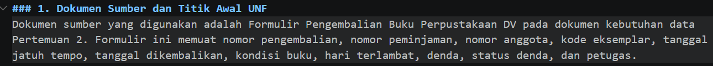
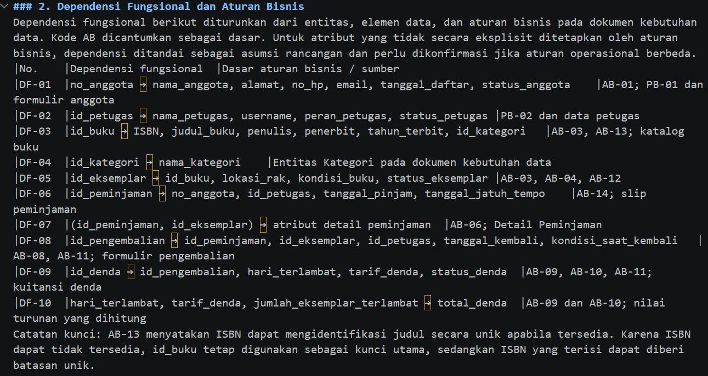
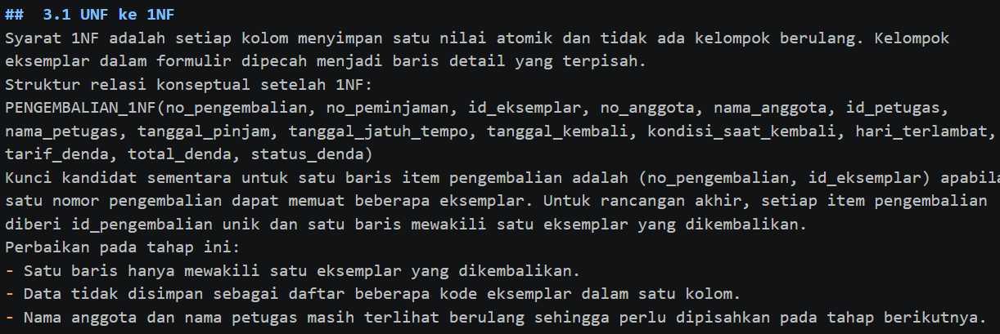
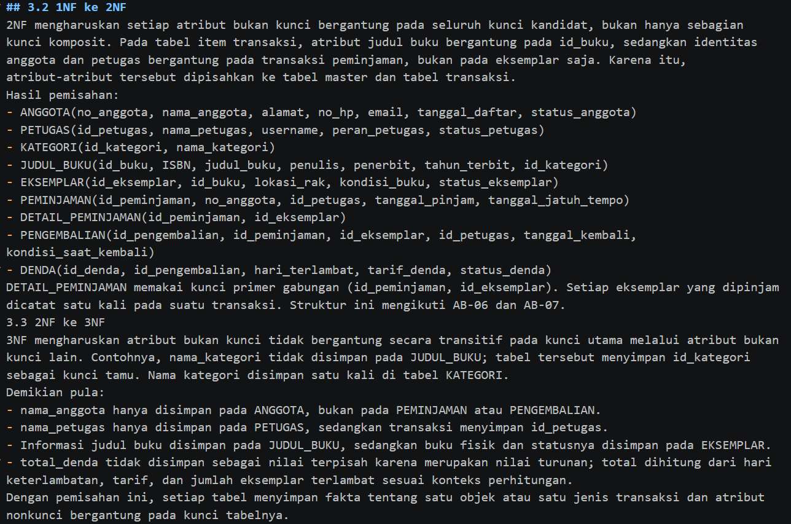
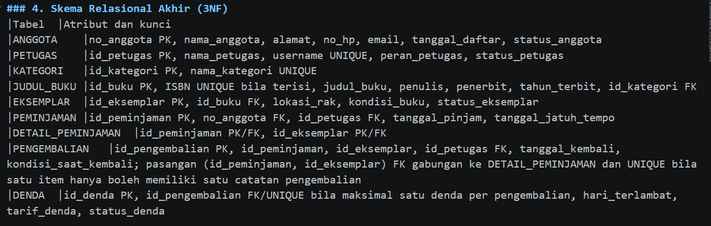
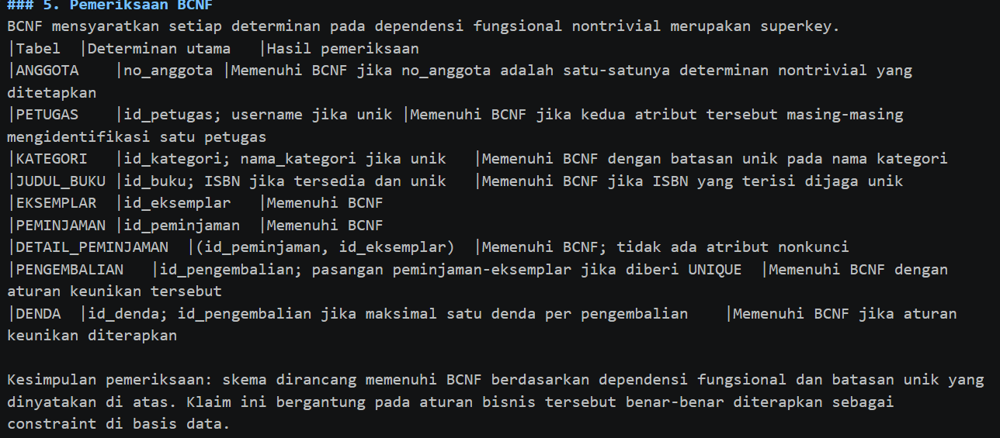
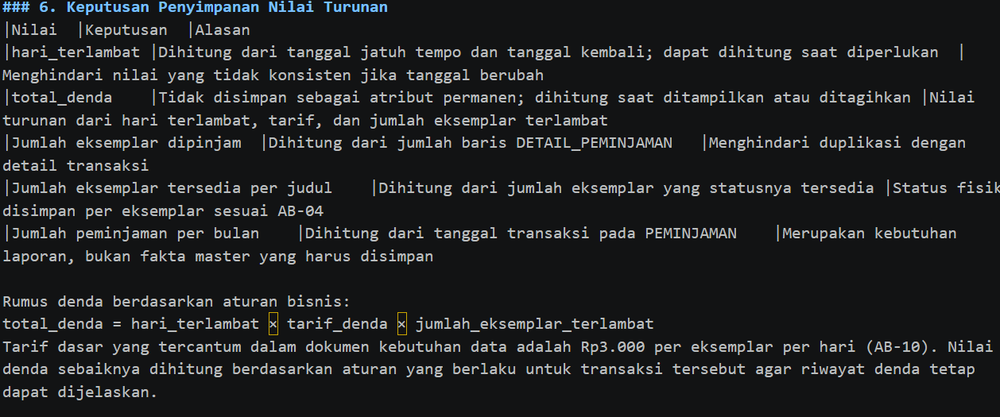

Laporan Praktikum Basis Data - Pertemuan 04

Nama: Devita Sari
NPM: 25430013
Kelas: A
Tanggal:15 Oktober 2026

### 1. Tujuan Praktikum
mengenali anomali ubah, sisip, dan hapus pada data yang masih satu tabel besar;
menurunkan dependensi fungsional dari aturan bisnis, bukan dari contoh data;
menormalisasi relasi dari UNF sampai 3NF dan memeriksa BCNF;
memutuskan nilai turunan disimpan atau dihitung, lalu mendokumentasikan skema akhirnya.

### 2. Ringkasan Dasar Teori
Data yang ditulis berulang dalam satu tabel menimbulkan tiga anomali. Anomali ubah terjadi saat satu fakta ada di banyak baris dan hanya sebagian yang diperbarui. Anomali sisip terjadi saat suatu fakta belum bisa dicatat karena fakta lain belum ada. Anomali hapus terjadi saat menghapus satu fakta ikut menghilangkan fakta lain.
Penyebabnya adalah dependensi fungsional (A -> B), yaitu setiap nilai A menentukan tepat satu nilai B. Dependensi ini harus diturunkan dari aturan bisnis. Contoh data hanya bisa membantah sebuah dependensi, tidak bisa membuktikannya.
Normalisasi berjalan bertahap. 1NF mensyaratkan nilai atomik dan tidak ada grup berulang. 2NF menghilangkan ketergantungan pada sebagian kunci komposit. 3NF menghilangkan rantai A -> B -> C antaratribut non-kunci. BCNF mensyaratkan setiap penentu adalah kunci kandidat. Tujuan normalisasi adalah menghilangkan anomali, bukan memperbanyak tabel.

### 3. Hasil Langkah Percobaan
 ## 1. Dari UNF ke 1NF
Bentuk Unnormalized Form (UNF) merupakan bentuk data yang masih memiliki grup berulang. Pada data penjualan Kopma, satu nota dapat menyimpan beberapa barang beserta jumlah, harga satuan, dan subtotal masing-masing barang. Hal ini sesuai dengan aturan bisnis AB-01, yaitu setiap nota memiliki nomor unik dan minimal satu baris barang. p02_kebutuhan _data_kopma_25430013.md

Contoh struktur UNF:
NOTA_UNF (
    no_nota_penjualan,
    tgl_penjualan,
    kode_petugas,
    nama_petugas,
    no_anggota,
    nama_anggota,
    {
        kode_barang,
        nama_barang,
        qty_detail_penjualan,
        harga_satuan_detail_penjualan,
        subtotal_detail_penjualan
    },
    jumlah_penjualan,
    diskon_penjualan,
    total_penjualan
)
Keterangan:
- no_nota_penjualan merupakan nomor unik setiap nota.
- kode_petugas dan nama_petugas menunjukkan kasir yang melayani transaksi.
- no_anggota dan nama_anggota mencatat anggota apabila pembeli merupakan anggota koperasi.
- Grup {...} menunjukkan data barang yang dapat berulang dalam satu nota.
- jumlah_penjualan, diskon_penjualan, dan total_penjualan merupakan informasi total transaksi.
## 2. Menghilangkan grup berulang menjadi 1NF
Pada tahap ini, grup barang yang berulang dipisahkan sehingga satu baris hanya mewakili satu barang dalam satu nota. Setiap atribut memiliki nilai atomik dan tidak berisi daftar beberapa barang dalam satu kolom.
Struktur relasi setelah diubah menjadi 1NF:
NOTA_1NF (
    no_nota_penjualan,
    kode_barang,
    tgl_penjualan,
    kode_petugas,
    nama_petugas,
    no_anggota,
    nama_anggota,
    nama_barang,
    qty_detail_penjualan,
    harga_satuan_detail_penjualan,
    subtotal_detail_penjualan,
    jumlah_penjualan,
    diskon_penjualan,
    total_penjualan
)
Kunci primer komposit:
(no_nota_penjualan, kode_barang)
Kunci tersebut digunakan dengan asumsi bahwa satu barang hanya dicatat satu kali dalam satu nota. Jika barang yang sama boleh muncul pada beberapa baris dalam satu nota, diperlukan atribut tambahan seperti no_urut_detail sebagai bagian dari kunci primer.
Contoh tabel 1NF:
|no_nota_penjualan|kode_barang|nama_barang|qty_detail_penjualan|harga_satuan_detail_penjualan |subtotal_detail_penjualan
|PJ-2609-0142	|BRG001	|Buku Tulis	|2	|5.000	|10.000
|PJ-2609-0142	|BRG002	|Pulpen	    |3	|4.000	|12.000
|PJ-2609-0142	|BRG003	|Penghapus	|1	|7.000	|7.000

Pada tahap ini, data penjualan Kopma yang awalnya memiliki grup barang berulang diubah menjadi bentuk 1NF. Setiap barang dalam satu nota dicatat pada baris terpisah sehingga setiap atribut memiliki nilai atomik. Kunci primer menggunakan kombinasi no_nota_penjualan dan kode_barang. Tahap ini bertujuan menghilangkan grup berulang dan membuat data lebih terstruktur.

## 3. 2 Menuliskan Dependensi Fungsional
Dependensi fungsional diturunkan dari aturan bisnis yang telah ditentukan pada Pertemuan 2, bukan hanya berdasarkan isi spreadsheet. Dependensi fungsional menjelaskan hubungan antara atribut penentu (determinant) dengan atribut yang nilainya ditentukan.
FD1: no_nota_penjualan
     -> tgl_penjualan, kode_petugas, no_anggota
     (AB-01)

FD2: kode_petugas
     -> nama_petugas

FD3: no_anggota
     -> nama_anggota
     (AB-05)

FD4: kode_barang
     -> nama_barang

FD5: (no_nota_penjualan, kode_barang)
     -> qty_detail_penjualan,
        harga_satuan_detail_penjualan
     (AB-04)

FD6: (qty_detail_penjualan,
      harga_satuan_detail_penjualan)
     -> subtotal_detail_penjualan
     (turunan)

     Keterangan
1. FD1: Nomor nota menentukan tanggal penjualan, petugas yang melayani, dan anggota yang melakukan transaksi.
2. FD2: Kode petugas menentukan nama petugas yang bertugas sebagai kasir.
3. FD3: Nomor anggota menentukan nama anggota. NIM anggota juga bersifat unik sesuai AB-05.
4. FD4: Kode barang menentukan nama barang.
5. FD5: Kombinasi nomor nota dan kode barang menentukan jumlah barang serta harga satuan yang digunakan dalam transaksi. Harga satuan disimpan sesuai AB-04 agar tidak berubah ketika harga barang diperbarui.
6. FD6: Subtotal detail penjualan merupakan nilai turunan yang dihitung dari jumlah barang dikalikan harga satuan.
Rumus subtotal:
                subtotal ={qty} {harga satuan}

Pada tahap ini, dependensi fungsional ditentukan berdasarkan aturan bisnis yang telah dibuat pada Pertemuan 2. Nomor nota menentukan informasi transaksi, kode petugas menentukan nama petugas, nomor anggota menentukan nama anggota, dan kode barang menentukan nama barang. Selain itu, kombinasi nomor nota dan kode barang menentukan jumlah serta harga satuan barang dalam transaksi. Dependensi fungsional digunakan sebagai dasar untuk menentukan pemisahan tabel pada proses normalisasi berikutnya.

## 3. 3 Menuju 2NF dan 3NF
## 4. 2NF (Second Normal Form)
Pada tahap 2NF, FD1 dan FD4 hanya bergantung pada sebagian kunci komposit. Oleh karena itu, atribut yang bergantung pada nomor nota dipisahkan ke relasi penjualan, sedangkan atribut yang bergantung pada kode barang dipisahkan ke relasi barang. Atribut yang tersisa menjadi relasi detail penjualan.
## 5. 3NF (Third Normal Form)
Pada tahap 3NF, ketergantungan transitif dihilangkan. Dalam relasi penjualan terdapat ketergantungan no_nota_penjualan → kode_petugas → nama_petugas dan no_nota_penjualan → no_anggota → nama_anggota. Oleh karena itu, data petugas dan anggota dipisahkan menjadi relasi tersendiri agar tidak terjadi pengulangan data.
## 6. Nilai Turunan
Atribut subtotal_detail_penjualan, jumlah_penjualan, dan total_penjualan merupakan nilai turunan yang dapat dihitung dari data detail penjualan dan aturan diskon anggota. Nilai tersebut tidak disimpan sebagai atribut permanen dalam tabel operasional agar mengurangi risiko ketidakkonsistenan data.

Hasil relasi setelah normalisasi
PENJUALAN (
    no_nota_penjualan,
    tgl_penjualan,
    kode_petugas*,
    no_anggota*,
    bayar_penjualan
)

DETAIL_PENJUALAN (
    no_nota_penjualan*,
    kode_barang*,
    qty_detail_penjualan,
    harga_satuan_detail_penjualan
)

BARANG (
    kode_barang,
    nama_barang,
    kategori_barang,
    harga_jual_barang,
    stok_barang,
    stok_min_barang
)

PETUGAS (
    kode_petugas,
    nama_petugas,
    peran_petugas
)

ANGGOTA (
    no_anggota,
    nim_anggota,
    nama_anggota,
    prodi_anggota,
    no_hp_anggota,
    status_anggota,
    tgl_daftar_anggota
)
Keterangan kunci:
- no_nota_penjualan adalah kunci primer pada tabel PENJUALAN.
- (no_nota_penjualan, kode_barang) adalah kunci primer komposit pada tabel DETAIL_PENJUALAN, dengan asumsi satu barang dicatat satu kali per nota.
- kode_barang adalah kunci primer pada tabel BARANG.
- kode_petugas adalah kunci primer pada tabel PETUGAS.
- no_anggota adalah kunci primer pada tabel ANGGOTA.
- Tanda * menunjukkan kunci tamu (foreign key).

Pada tahap ini, data dipisahkan menjadi beberapa tabel untuk menghilangkan ketergantungan parsial dan transitif. Data penjualan, detail penjualan, barang, petugas, dan anggota ditempatkan pada relasi masing-masing. Nilai turunan seperti subtotal, jumlah penjualan, dan total penjualan dapat dihitung dari data transaksi serta aturan diskon yang berlaku. Pemisahan ini membantu mengurangi duplikasi dan menjaga konsistensi data.

## 3. 4 Mencocokkan dengan skema kanonik dan memeriksa BCNF
## 7. Membandingkan hasil normalisasi dengan skema kanonik Kopma
Skema kanonik menggunakan kunci pengganti (surrogate key) sebagai kunci primer, sedangkan kode alami seperti no_nota_penjualan digunakan sebagai kunci unik. Berikut tabel pencocokan skema kanonik berdasarkan gambar acuan.
Tabel 1. Pencocokan skema relasional dengan skema kanonik
|Tabel	             |Kunci primer	           |Kunci unik	             |Kunci tamu
|barang	             |id_barang	               |kode_barang	             |—
|pemasok	         |id_pemasok	           |—	                     |—
|petugas	         |id_petugas	           |kode_petugas             |—
|anggota	         |id_anggota	           |no_anggota, nim_anggota	 |—
|penjualan	         |id_penjualan	           |no_nota_penjualan	     |id_petugas, id_anggota (boleh NULL)
|detail_penjualan	 |(id_penjualan, id_barang)|—	                     |id_penjualan, id_barang
|pembelian	         |id_pembelian	           |—	                     |id_pemasok
|detail_pembelian	 |(id_pembelian, id_barang)|—	                     |id_pembelian, id_barang
## 8. Pemeriksaan BCNF
BCNF (Boyce-Codd Normal Form) mensyaratkan bahwa setiap penentu (determinant) dalam dependensi fungsional nontrivial harus merupakan kunci kandidat.
|Tabel	                 |Penentu yang diperiksa	          |Hasil
|barang	                 |id_barang, kode_barang	          |Memenuhi BCNF karena keduanya mengidentifikasi barang secara unik.
|pemasok                 |id_pemasok	                      |Memenuhi BCNF berdasarkan kunci primer yang tersedia.
|petugas                 |id_petugas, kode_petugas	          |Memenuhi BCNF karena kode petugas merupakan kunci unik.
|anggota                 |id_anggota, no_anggota, nim_anggota |Memenuhi BCNF karena atribut tersebut merupakan kunci unik.
|penjualan               |id_penjualan, no_nota_penjualan	  |Memenuhi BCNF karena nomor nota bersifat unik.
|detail_penjualan        |(id_penjualan, id_barang)	          |Memenuhi BCNF karena pasangan tersebut merupakan kunci primer komposit dan tidak memiliki atribut nonkunci.
|pembelian	             |id_pembelian                        |Memenuhi BCNF berdasarkan kunci primer yang tersedia.
|detail_pembelian        |(id_pembelian, id_barang)	          |Memenuhi BCNF karena pasangan tersebut merupakan kunci primer komposit dan tidak memiliki atribut nonkunci.

Pada tahap ini, hasil normalisasi dibandingkan dengan skema kanonik Kopma yang terdapat pada buku praktikum. Perbandingan dilakukan terhadap kunci primer, kunci unik, dan kunci tamu setiap tabel. Skema kanonik menggunakan kunci pengganti seperti id_barang dan id_penjualan sebagai kunci primer, sedangkan kode alami seperti kode_barang dan no_nota_penjualan digunakan sebagai kunci unik. Selanjutnya, pemeriksaan BCNF dilakukan untuk memastikan bahwa setiap penentu pada dependensi fungsional nontrivial merupakan kunci kandidat. Hasil normalisasi kemudian disimpan dalam berkas proyek dan dicatat melalui commit Git.

### 4. Jawaban Titik Analisis
 ## Titik Analisis 1.
Mengapa FD5 menempatkan harga_satuan_detail_penjualan pada kunci (no_nota_penjualan, kode_barang), bukan pada kode_barang saja? Apa yang terjadi pada laporan omzet tahun lalu jika harga_satuan_detail_penjualan dipindah ke tabel barang?
FD5 menaruh harga pada kunci (no_nota_penjualan, kode_barang) karena AB-04 menyatakan harga di nota tidak berubah walau harga barang kemudian naik. Harga ditentukan oleh kombinasi nota dan barang, bukan oleh barang saja. Jika harga dipindah ke tabel barang, setiap kenaikan harga akan mengubah nilai semua nota lama yang memuat barang itu. Misalnya pulpen naik dari Rp4.000 menjadi Rp4.500: 100 pulpen yang terjual tahun lalu akan terhitung Rp450.000 pada laporan omzet, padahal uang yang diterima Rp400.000. Laporan omzet tahun lalu menjadi salah dan tidak bisa dipulihkan.

## Titik Analisis 2. 
Keputusan “total tidak disimpan” akan ditinjau ulang di Buku 2 Modul 2, ketika tabel arsip penjualan justru menyimpan total. Mengapa keputusan yang berbeda itu tetap konsisten? Petunjuk: bedakan data operasional yang masih dapat berubah dari potret historis yang tidak boleh berubah?
Pada tabel operasional, total bisa dihitung dari detail yang masih bisa berubah, sehingga menyimpannya berisiko tidak sinkron. Karena itu total tidak disimpan. Tabel arsip penjualan adalah potret historis yang tidak boleh berubah lagi setelah periodenya ditutup, sehingga total yang tersimpan di sana adalah catatan nilai pada saat itu dan tidak perlu mengikuti perubahan data lain. Prinsipnya sama: nilai turunan hanya disimpan bila sumbernya tidak akan berubah lagi.

## Titik Analisis 3. 
Kolom pemasok_brg di spreadsheet lama tidak muncul di tabel barang. Di mana informasi “barang ini dipasok oleh siapa” kini disimpan? Apa keuntungannya dibanding menyimpan satu nama pemasok di tabel barang?
Informasi "barang ini dipasok oleh siapa" disimpan di riwayat pembelian: pembelian merujuk ke pemasok, dan detail_pembelian merujuk ke pembelian dan barang. Keuntungannya: (a) satu barang bisa dipasok banyak pemasok dan satu pemasok memasok banyak barang, padahal satu kolom nama pemasok di tabel barang hanya mampu menyimpan satu; (b) Kopma bisa berganti pemasok tanpa mengubah data barang; (c) riwayat siapa memasok apa, kapan, dan berapa harga belinya tetap tersimpan; (d) tidak ada ejaan nama pemasok yang berubah-ubah seperti pada spreadsheet lama.

### 5. Hasil Latihan dan Modifikasi
1. Menyimpan Beberapa Nomor Telepon untuk Setiap Pemasok
Untuk mencatat beberapa nomor telepon bagi setiap pemasok, diperlukan tabel baru bernama TELEPON_PEMASOK. Tabel ini dibuat agar satu pemasok dapat memiliki lebih dari satu nomor telepon tanpa menyimpan beberapa nomor dalam satu kolom.
Struktur relasinya adalah:
PEMASOK (
    id_pemasok (PK),
    kode_pemasok,
    nama_pemasok,
    alamat_pemasok
)

TELEPON_PEMASOK (
    id_pemasok (PK, FK),
    no_telepon (PK)
)
Keterangan:
- id_pemasok pada tabel PEMASOK merupakan kunci primer.
- id_pemasok pada tabel TELEPON_PEMASOK merupakan kunci tamu yang mengacu ke tabel PEMASOK.
- no_telepon menyimpan satu nomor telepon untuk setiap baris.
- Kunci primer gabungan (id_pemasok, no_telepon) memungkinkan satu pemasok mempunyai beberapa nomor telepon yang berbeda.
Contoh data:
Tabel PEMASOK
|id_pemasok	|nama_pemasok
|P001	|CV Maju Jaya

Tabel TELEPON_PEMASOK
|id_pemasok	|no_telepon
|P001	|081234567890
|P001	|085678901234
Dengan pemisahan ini, setiap nomor telepon memiliki nilai atomik dan struktur data lebih terorganisasi. Hubungan antara pemasok dan nomor telepon adalah one-to-many (1:N).

Nomor telepon pemasok dipisahkan ke tabel TELEPON_PEMASOK agar satu pemasok dapat memiliki beberapa nomor telepon. Tabel dihubungkan menggunakan id_pemasok sebagai kunci tamu sehingga data lebih terstruktur dan tidak berulang.

## 2 Contoh Pelanggaran 3NF dan Anomali Ubah
Jika atribut nama_anggota disimpan langsung di tabel PENJUALAN, maka nama anggota akan berulang pada setiap transaksi yang dilakukan anggota tersebut. Hal ini menimbulkan ketergantungan transitif karena no_nota_penjualan menentukan no_anggota, sedangkan no_anggota menentukan nama_anggota.
Contoh tabel yang belum memenuhi 3NF:
|no_nota_penjualan	|no_anggota	|nama_anggota	|total_penjualan
|PJ001	|A-0001	|Budi	|50000
|PJ002	|A-0001	|Budi	|75000
|PJ003	|A-0002	|Siti	|40000
Contoh anomali ubah: Jika nama anggota Budi berubah menjadi Budi Santoso, nama tersebut harus diperbarui pada semua nota miliknya. Apabila hanya satu baris yang diubah, data anggota menjadi tidak konsisten.
Contoh kueri SQL untuk memperlihatkan anomali tersebut:
UPDATE PENJUALAN
SET nama_anggota = 'Budi Santoso'
WHERE no_nota_penjualan = 'PJ001';
Setelah kueri dijalankan, hanya nota PJ001 yang berubah, sedangkan nota PJ002 masih mencatat nama Budi. Akibatnya, informasi anggota menjadi tidak konsisten.
Solusi normalisasi: Pisahkan data anggota ke tabel ANGGOTA dan simpan no_anggota sebagai kunci tamu pada tabel PENJUALAN.
ANGGOTA (
    no_anggota (PK),
    nama_anggota
)

PENJUALAN (
    id_penjualan (PK),
    no_nota_penjualan (UNIQUE),
    no_anggota (FK),
    total_penjualan
)
Dengan struktur ini, perubahan nama anggota cukup dilakukan satu kali pada tabel ANGGOTA, sehingga anomali ubah dapat dihindari.

Penyimpanan nama_anggota pada tabel PENJUALAN menyebabkan pengulangan data dan ketergantungan transitif. Jika nama anggota berubah, semua transaksi terkait harus diperbarui. Solusinya adalah memisahkan data anggota ke tabel ANGGOTA agar perubahan nama cukup dilakukan satu kali.

### 6. Tugas Mandiri: Milestone Proyek 04
## 6.1 dokumen sumber proyek 

## 6.2 dependensi fungsional 

## 6.3  tahapan 1NF, 2NF, 3NF, dan hasil pemeriksaan BCNF.

## 6. 4  penyimpanan setiap nilai turunan

### 7. Pembahasan dan Kendala
Saya mempelajari proses normalisasi basis data dari UNF hingga 3NF untuk mengurangi duplikasi data dan mencegah anomali penyisipan, perubahan, serta penghapusan data. Saya juga mempelajari cara menentukan dependensi fungsional berdasarkan aturan bisnis dan menyusun tabel dengan kunci primer serta kunci tamu yang sesuai.
Kendala yang dihadapi adalah menentukan dependensi fungsional yang tepat dan memisahkan atribut ke dalam tabel yang sesuai agar tidak terjadi ketergantungan yang tidak diperlukan. Kendala tersebut diatasi dengan memeriksa kembali aturan bisnis, memperhatikan ketergantungan antaratribut, dan mengevaluasi hasil normalisasi agar struktur basis data menjadi lebih terorganisasi.

### 8. Kesimpulan
Normalisasi membantu menghasilkan struktur basis data yang lebih terorganisasi dengan mengurangi duplikasi dan mencegah anomali. Melalui tahapan UNF hingga 3NF, dependensi fungsional dapat dianalisis untuk menentukan pemisahan tabel yang tepat. Hasil normalisasi menjadi dasar penyusunan struktur tabel pada modul berikutnya.

### 9. Pernyataan Penggunaan AI
Saya menggunakan ChatGPT untuk membantu memahami konsep normalisasi. Hasil analisis proyek, pemeriksaan dependensi fungsional, serta bukti praktikum disesuaikan dengan pekerjaan dan hasil yang saya lakukan sendiri.

### 10. Bukti Git
Repositori: https://github.com/.../basisdata-<NIM>
Commit berkas normalisasi: p04: normalisasi kopma - hash: ...
Commit laporan: p04: laporan pertemuan 4 - hash: ...
Checklist
